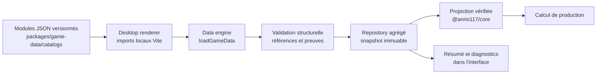

# Architecture des données

## Architecture cible et flux d'exécution

Le desktop importe les modules JSON à la compilation. Il n'effectue aucun appel réseau ni lecture de fichiers de données à l'exécution. Les données sont transmises à `loadGameData`, qui valide leur structure, construit un snapshot isolé et expose une projection conservatrice au moteur de calcul.

## Responsabilités

- **`packages/game-data`** : types canoniques, modules JSON, statuts de vérification et règles de validation.
- **`packages/data-engine`** : agrégation des modules, validation bloquante, snapshot immuable et projection vers le contrat de `@anno117/core`.
- **`packages/core`** : calcul métier, indépendant d'Electron et de React.
- **`apps/desktop`** : chargement des données locales au travers des imports Vite et affichage de l'état du catalogue.

## Règles de sûreté des données

Seules les ressources, bâtiments, recettes et catégories de population ayant le statut `verified` ou `derived` peuvent entrer dans la projection du moteur. Les éléments `to-observe`, `observed`, `disputed` et `excluded` restent exclus des calculs. Une erreur structurelle bloque le chargement et est affichée dans l'interface.

Les régions Latium et Albion sont présentes comme périmètre de travail, au statut `to-observe`. Elles ne constituent pas une validation des caractéristiques de jeu. Les autres modules sont initialisés mais vides : le catalogue de production doit être établi par observation indépendante.

## État de l'intégration

- [x] Modules JSON locaux et modèle typé.
- [x] Validation structurelle et références internes.
- [x] Agrégation et projection vers le moteur de calcul.
- [x] Chargement du catalogue dans le renderer desktop.
- [x] Affichage du résumé des modules et des erreurs de validation.
- [ ] Exécution locale de `pnpm test` et `pnpm typecheck`.
- [ ] Build et démarrage du desktop compilé.
- [ ] Constitution et validation du catalogue en jeu.

La compilation et l'exécution locale restent à confirmer sur un poste de développement ; cette documentation ne prétend pas que ces contrôles ont déjà été exécutés.
