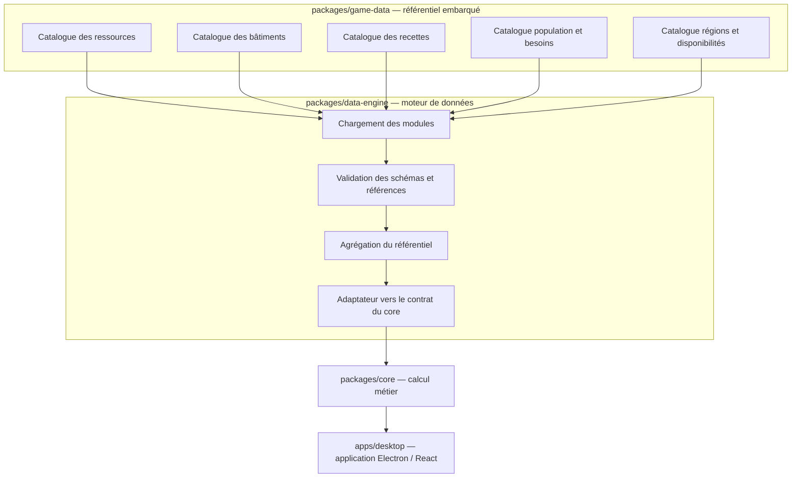

# Architecture des données — Anno 117 Planner

**Version :** 1.0  
**Statut :** proposition de travail — architecture à valider  
**Branche :** `feature/data-catalog-engine`

## 1. Objectif

Cette architecture sépare les données du jeu, leur préparation et leur consommation par le moteur métier. Elle vise un fonctionnement entièrement local : les données nécessaires à l'application sont embarquées dans sa distribution et aucune interrogation d'un service externe n'est requise à l'exécution.

## 2. Vue d'ensemble

Le moteur de données est une dépendance du produit et un fournisseur de données du `core`. Le `core` ne connaît ni les fichiers, ni leur organisation, ni les sources de collecte.

## 3. Responsabilités

| Composant | Responsabilité | Hors responsabilité |
|---|---|---|
| `game-data` | Définir et embarquer les catalogues, leurs identifiants et métadonnées | Calculer, optimiser ou charger des données distantes |
| `data-engine` | Charger les ensembles, valider les références, agréger et exposer un référentiel cohérent | Déterminer une stratégie de production ou optimiser les bâtiments |
| `core` | Calculer les besoins, flux, capacités et dimensionnements à partir d'un contrat stable | Connaître les formats et chemins des catalogues |
| `product` | Orchestrer les cas d'usage de l'application | Porter les données brutes du jeu |
| `desktop` | Présenter les résultats et recueillir les paramètres utilisateur | Réimplémenter les règles du moteur |

## 4. Découpage fonctionnel des catalogues

Les ensembles sont séparés par domaine fonctionnel et reliés par des identifiants stables :

- **Ressources et biens** : matières premières, produits intermédiaires et produits finis.
- **Bâtiments** : identité, région, catégorie et caractéristiques nécessaires au modèle.
- **Production** : recettes, entrées, sorties et durées de cycle.
- **Population et besoins** : paliers, résidences et consommations.
- **Régions** : Latium et Albion, avec leurs caractéristiques.
- **Disponibilités insulaires** : fertilités, gisements et autres ressources naturelles locales.

Une information de référence ne doit être définie qu'à un seul endroit. Les autres ensembles la référencent par identifiant.

## 5. Cycle de chargement

1. Charger les modules locaux déclarés dans le manifeste du catalogue.
2. Vérifier leur version et leur compatibilité avec le schéma attendu.
3. Vérifier les identifiants uniques, les références croisées, les unités et les valeurs.
4. Agréger les ensembles dans un référentiel immuable.
5. Construire la vue compatible avec le contrat du `core`.
6. Refuser le démarrage du calcul si une incohérence bloquante est détectée.

Les erreurs doivent être explicites et localisables (ensemble, identifiant, champ). Aucune valeur manquante ne doit être remplacée silencieusement par zéro.

## 6. Provenance et niveau de confiance

La provenance d'étude et le statut de validation sont deux notions distinctes. Une source externe peut avoir servi à identifier une question à vérifier sans devenir la provenance d'une donnée intégrée.

Les données du catalogue applicatif doivent être issues d'observations ou d'expérimentations propres au projet, ou de calculs dérivés de telles observations. Les pistes issues de sources secondaires restent dans la documentation d'audit jusqu'à leur vérification indépendante.

Chaque donnée intégrée doit, selon sa nature, conserver :
- une méthode d'établissement (observation, expérimentation, calcul dérivé) ;
- un statut de vérification ;
- la version du jeu observée ;
- la date et les notes utiles ;
- les références internes aux observations dont elle dépend.

Les valeurs non vérifiées ne sont pas présentées comme des valeurs de référence. Les valeurs dérivées conservent les liens vers leurs données d'entrée.

## 7. Embarquement et fonctionnement hors ligne

Les catalogues sont des ressources locales versionnées avec le code. Le moteur ne réalise aucun appel réseau et ne dépend d'aucun service communautaire à l'exécution.

Une évolution des données est livrée avec une version de l'application. Le manifeste permet d'identifier la version du jeu et du schéma couverts.

## 8. Principes de compatibilité

- Le contrat public du `core` reste indépendant du modèle de stockage.
- Les identifiants sont stables et ne dépendent pas des libellés traduits.
- Les unités sont explicites ; les durées et débits suivent les conventions documentées par le contrat du `core`.
- Les catalogues sont validés avant exposition.
- L'agrégation ne modifie pas les données sources.
- Le chargement est déterministe et reproductible.

## 9. État de réalisation

Cette architecture décrit la cible de la branche. Le dépôt contient déjà un premier package `game-data` avec types, validation et conversion vers le `core`. La branche doit faire évoluer cette base sans introduire de contrat concurrent. Le package `data-engine` et le découpage modulaire du catalogue seront introduits progressivement.

Le premier catalogue de production restera volontairement incomplet tant que les valeurs n'auront pas été relevées ou vérifiées en jeu. Les inventaires provenant de sources secondaires constituent des pistes de vérification, pas des données approuvées à embarquer.

## 10. Documents associés

- [Contrat du moteur de données](contrats/contrat-moteur-donnees.md)
- [Contrat du moteur de calcul](contrats/contrat-moteur-calcul.md)
- [Périmètre du catalogue](donnees/perimetre-catalogue.md)
- [Audit du catalogue](donnees/audit-catalogue-donnees.md)
- [Registre des sources et provenance](donnees/registre-sources-donnees.md)
