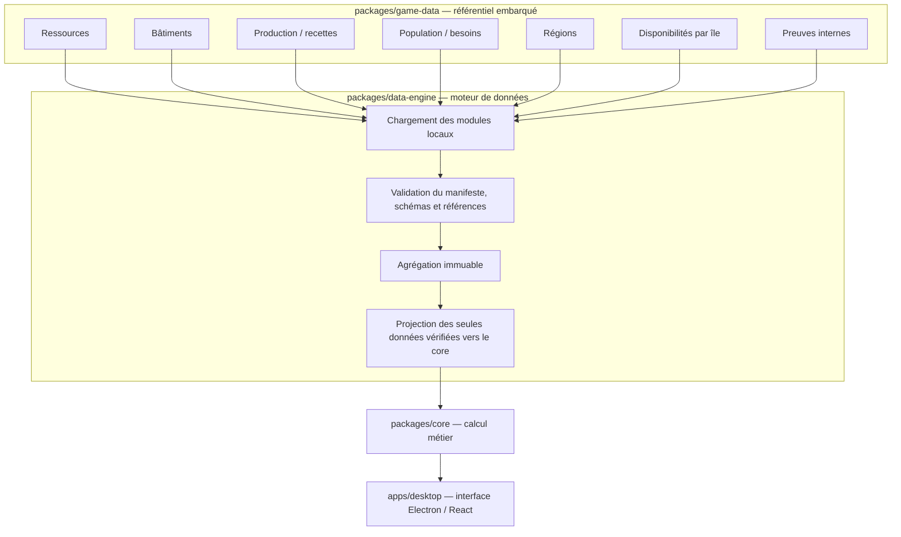

# Architecture des données — Anno 117 Planner

**Version :** 1.1  
**Statut :** architecture cible — réalisation progressive

## 1. Objectif

Séparer les données du jeu, leur validation/agrégation et leur consommation par le moteur métier. Les catalogues sont versionnés et embarqués dans l'application. Aucun service externe n'est requis à l'exécution.

## 2. Vue d'ensemble

## 3. Responsabilités

| Composant | Responsabilité |
|---|---|
| `game-data` | Modèle typé, modules versionnés et preuves internes |
| `data-engine` | Validation, agrégation, diagnostics et projection vers le contrat du core |
| `core` | Calcul métier à partir d'un catalogue déjà validé |
| `product` | Orchestration des cas d'usage |
| `desktop` | Interface, import local des modules et présentation |

Le `core` ne connaît ni les fichiers, ni leur organisation, ni les métadonnées de collecte.

## 4. Modules du catalogue

- `resources` : matières premières, biens intermédiaires, produits finis et services.
- `buildings` : bâtiments et région d'appartenance.
- `production` : recettes, intrants et sorties.
- `population` : paliers, capacité résidentielle et besoins.
- `regions` : Latium et Albion.
- `islandAvailability` : fertilités, gisements et ressources naturelles propres à chaque île.
- `evidence` : observations et expérimentations internes, utilisées comme preuves.

Chaque entité a un identifiant stable, un statut de vérification et des références vers des preuves internes. Une donnée dérivée référence les observations dont elle dépend. Les sources secondaires restent des pistes d'étude dans la documentation, non des preuves embarquées.

## 5. Statuts et projection

Les statuts sont `to-observe`, `observed`, `verified`, `derived`, `disputed` et `excluded`. Le référentiel agrégé conserve l'ensemble des statuts. La projection destinée au `core` retient uniquement les données `verified` ou `derived` et dont les dépendances sont cohérentes.

## 6. Cycle de chargement

1. L'application importe le manifeste et les modules JSON locaux.
2. `data-engine` valide le manifeste et les références.
3. Les modules sont agrégés sans mutation et les diagnostics sont conservés.
4. Le moteur construit une projection compatible avec `Catalog`.
5. Le `core` effectue les calculs.

Les erreurs sont localisées par code et chemin. Une valeur absente n'est jamais transformée silencieusement en zéro. Le moteur n'effectue aucun accès réseau.

## 7. Limites actuelles

Le modèle modulaire et l'agrégateur initial sont en cours d'implémentation. Le contrat du core actuel ne couvre pas encore les régions ni les disponibilités insulaires : ces informations restent dans le référentiel agrégé, en attendant une évolution fonctionnelle du core. Le chargement effectif des JSON par l'application desktop reste à raccorder.

Aucune valeur de jeu n'est préremplie dans les modules. Le premier catalogue sera constitué à partir d'une nouvelle campagne et validé par observation et expérimentation.

## 8. Documents associés

- [Contrat du moteur de données](contrats/contrat-moteur-donnees.md)
- [Plan de tests du catalogue](plan-tests-catalogue.md)
- [Contrat du moteur de calcul](contrats/contrat-moteur-calcul.md)
- [Périmètre du catalogue](donnees/perimetre-catalogue.md)
- [Stratégie de validation en jeu](donnees/strategie-validation-en-jeu.md)
